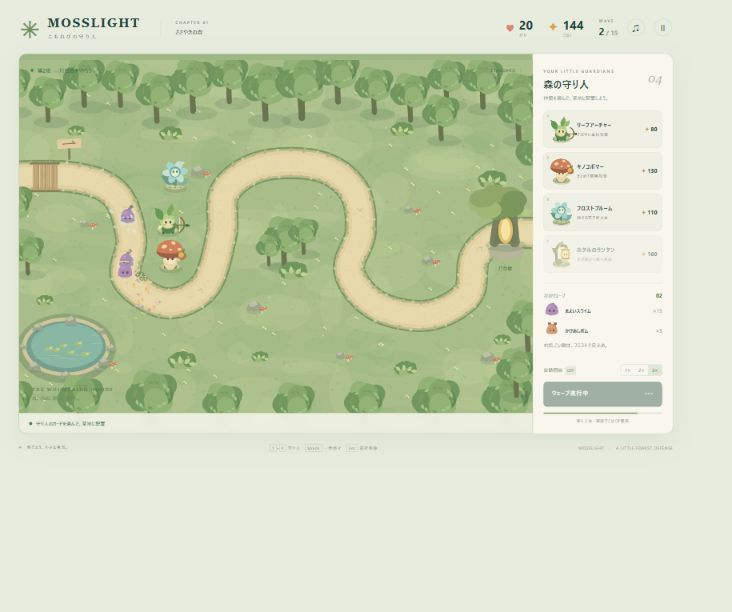
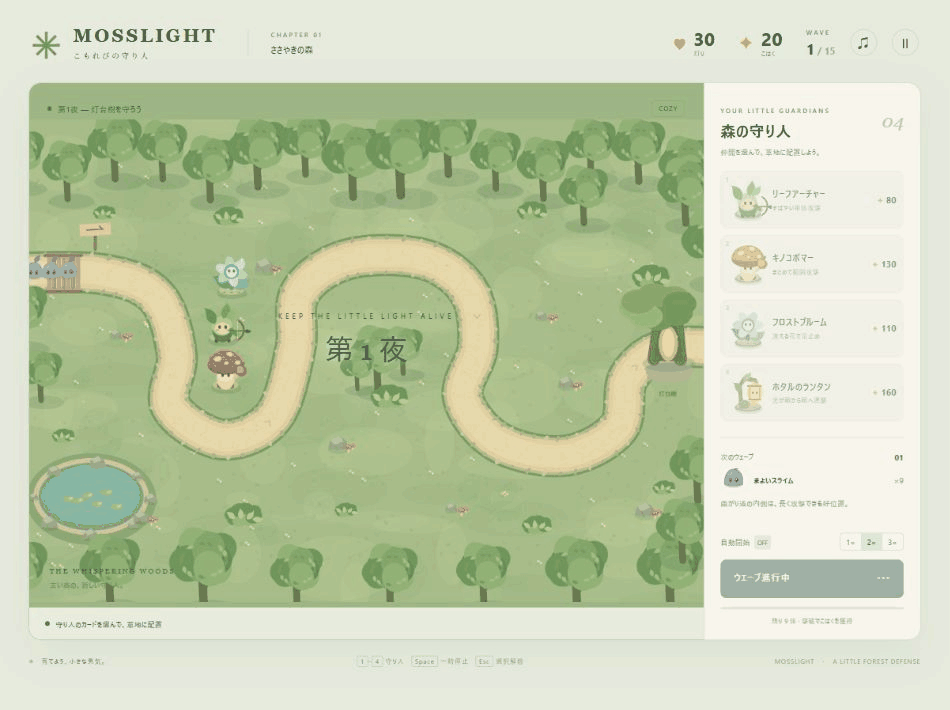

# Mosslight — こもれびの守り人

オリジナルの森を舞台にした、ブラウザ向けタワーディフェンスです。Canvas 2Dで描く絵本風の景色・キャラクターと、Web Audioによる音を内蔵しています。外部画像、フォント、ライブラリ、ネット接続は不要です。

**ゲーム本体は、下記のプロンプト一発で開発しました。** Codexに最初の制作依頼を渡した後、追加の指示や途中確認を挟まず、企画・設計・実装・アート制作・ブラウザでの動作確認・改善まで自律的に進めています。READMEへの画像・動画・制作プロンプトの掲載は、ゲーム完成後の追加依頼で行いました。

使用LLM：**OpenAI GPT-6**（開発エージェント：**Codex**）。

## プレイ画面



## プレイ動画

実際のブラウザで収録した、約9秒のループGIFです（のんびりモード・2倍速、音声なし）。敵の移動、攻撃・撃破エフェクト、ウェーブクリアまでを確認できます。



## 起動

**[ブラウザで今すぐプレイ](https://onego15.github.io/bloons-gpt/)** — GitHub Pagesで公開しています。ダウンロードやインストールは不要です。

一番簡単な方法は **index.html をブラウザで開く**ことです。インストールやビルドは不要です。

ローカルサーバーを使う場合は、このフォルダで次を実行します（Node.jsが必要です）。

```sh
npm start
```

ブラウザで http://127.0.0.1:4173 を開いてください。Windowsでは **start.bat** をダブルクリックしても起動できます。サーバー終了は起動したターミナルで Ctrl+C。既に起動済みの場合は既存のURLを開いてください。

## 遊び方

1. 難易度を選んで「森へ出かける」。
2. 守り人のカードを選び、道・木・池を避けて草地をクリック。
3. 「森を守る」でウェーブ開始。倒した敵とウェーブクリアでこはくを獲得。
4. 配置済みの守り人を選び、攻撃力か攻撃速度・射程を強化。合計3回まで育成できます。
5. 15ウェーブを越えれば勝利。灯りが0になると敗北です。

| 守り人 | 役割 |
|---|---|
| リーフアーチャー | 安価で速い単体攻撃 |
| キノコボマー | 爆発で複数の敵を攻撃。甲羅の防御を無視 |
| フロストブルーム | 花びらで敵を3秒間減速 |
| ホタルのランタン | 近くの敵へ連鎖する光 |

曲がり道の内側は射程内に敵がいる時間が長くなります。フロストとキノコを組み合わせ、終盤は出口側にも守り人を配置しましょう。売却時は購入・育成費用の70%が戻ります。

操作：1〜4で守り人を選択、Escまたは右クリックで選択解除、Spaceで一時停止。画面のボタンから1〜3倍速、自動ウェーブ開始、音のオン・オフを切り替えられます。別タブに切り替えると自動で一時停止します。

## 内容と検証

- 1マップ、4種類の守り人、5種類の敵、15ウェーブ、3難易度、勝利・敗北・再挑戦。
- 全アートは本作品用のCanvas描画。音もブラウザ内で合成し、第三者のアセットは使用していません。
- 実ブラウザで配置、ウェーブ開始・クリア、育成、売却、倍速、一時停止を操作確認。デスクトップ幅と小画面のレイアウトも確認。
- `node tests.cjs` で実際のゲームロジックを使い、全15ウェーブ、難易度別クリア、敗北、配置制約、育成上限、防御計算などを検証。
- 全15ウェーブの確認は自動シミュレーションです。すべての難易度をブラウザで手動通しプレイしたわけではありません。
- 実機のSafari・Firefox・スマートフォンは未検証。小画面ではマップと操作パネルが縦に並びます。
- セーブはクリア記録のみ。途中再開、複数マップ、オンライン機能、Steam連携は含みません。

## ファイル

- `index.html` / `style.css`：日本語UI、レスポンシブレイアウト
- `game.js`：描画、戦闘、ウェーブ、音、入力
- `serve.cjs` / `start.bat`：任意のローカルサーバー
- `tests.cjs`：ヘッドレスのゲームロジック検証

`npm run check` でJavaScriptの構文を確認できます。

## 最初の制作プロンプト

ゲーム制作時に入力したプロンプトの全文です。

<details>
<summary>制作プロンプトを表示</summary>

Bloons TD 6やKingdom Rushのような、カジュアルで中毒性のあるタワーディフェンスゲームを制作してください。

ブラウザで快適に動作し、Steamで販売されている良質なインディーゲームのような、完成度の高いゲームを目指してください。

**特に重視するのは、グラフィックの美しさ、統一されたアートスタイル、気持ちのよい攻撃演出、ゲームとしての面白さです。**

主な要素：

- カラフルで親しみやすい、オリジナルの世界観
- 個性的なタワーと複数種類の敵
- タワーの配置、アップグレード、売却
- 徐々に難しくなるウェーブと戦略性
- 派手で気持ちのよい攻撃・撃破エフェクト
- 直感的で洗練されたUI
- 最初から最後まで遊べるゲーム進行

グラフィックについては、単純な図形を並べたプロトタイプや、AIが作ったとすぐ分かるような統一感のない素材の寄せ集めにはしないでください。

2D・3Dの選択、ゲームエンジン、プログラミング言語、アセットの制作・調達方法は自由です。必要に応じて、利用条件を遵守した公開アセットを使用して構いません。

コンテンツの量よりも、見た目・操作感・ゲーム性の完成度を優先してください。

**私への途中確認や質問は不要です。**

企画、設計、実装、素材準備、テスト、バグ修正、ビジュアルの改善まで、利用可能なツールの範囲で自律的に進めてください。

実際にブラウザでゲームを起動し、プレイ画面を確認して、見た目や操作性の問題を改善してください。

最終的には、ブラウザでプレイできる状態のゲーム一式と起動方法を提出してください。未実装・未検証の部分があれば正直に報告してください。

</details>
